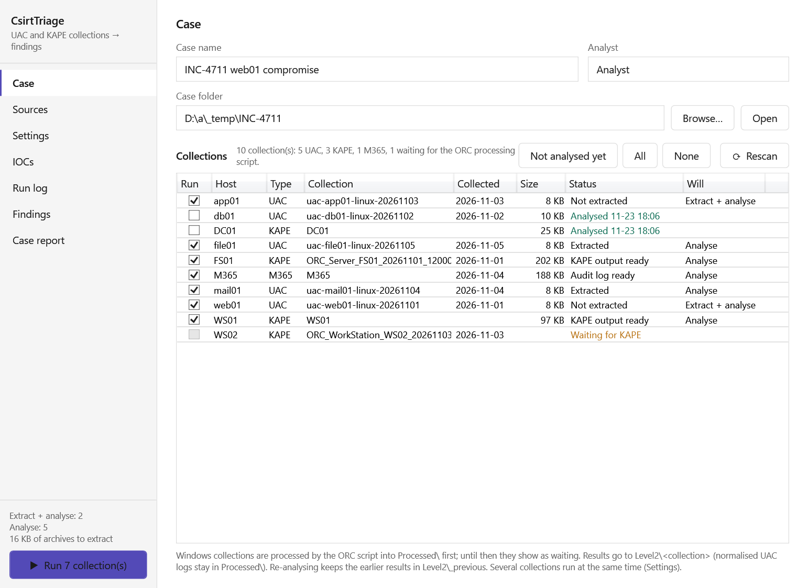
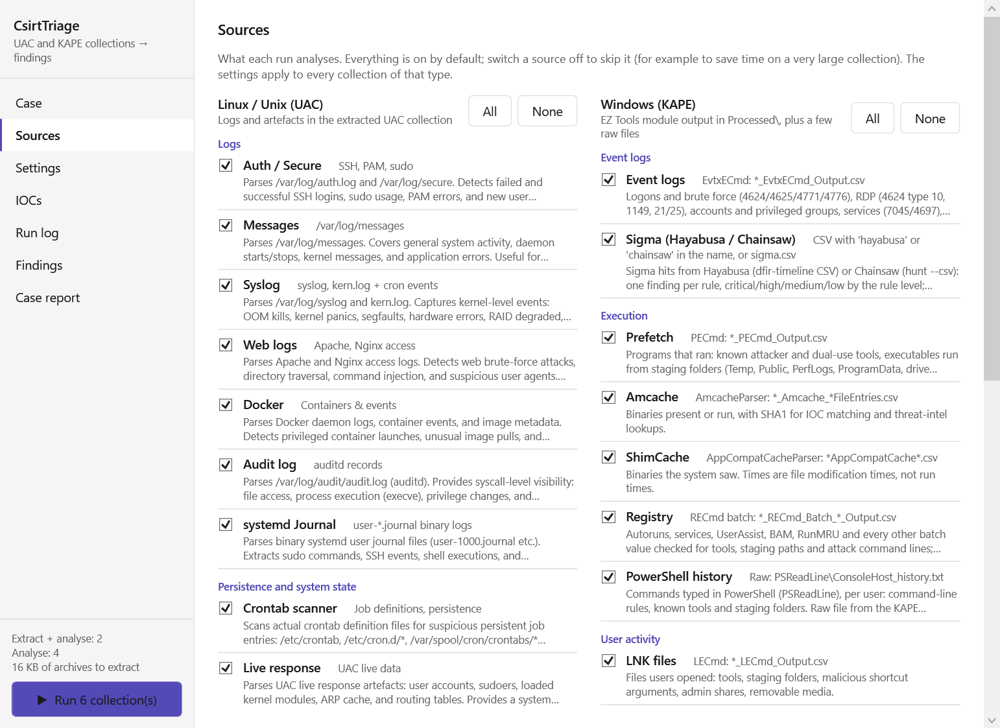
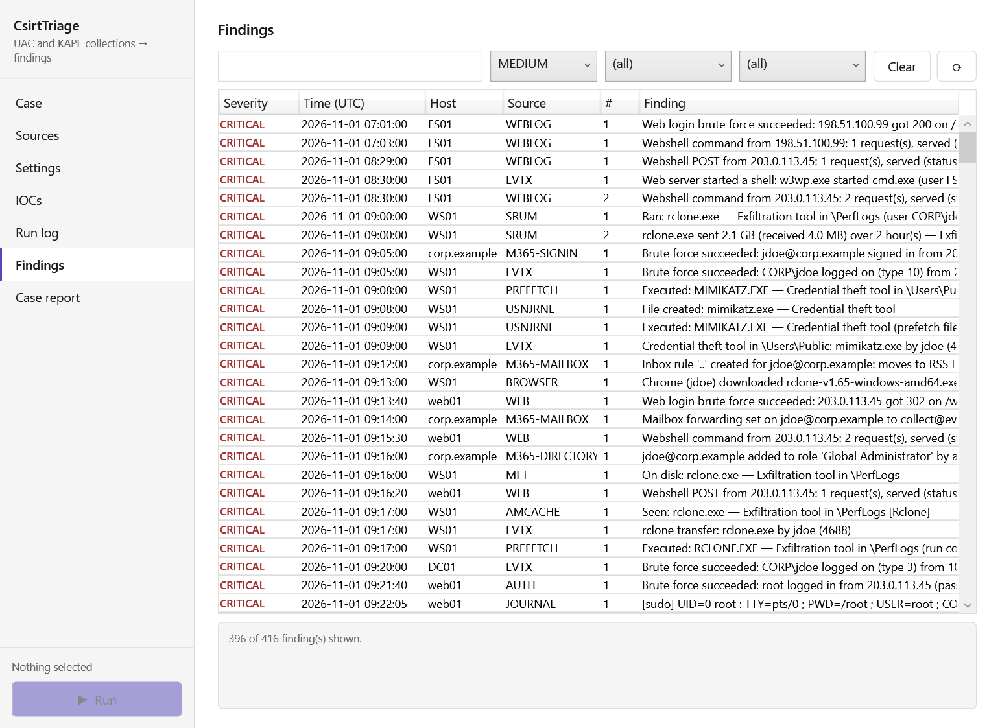
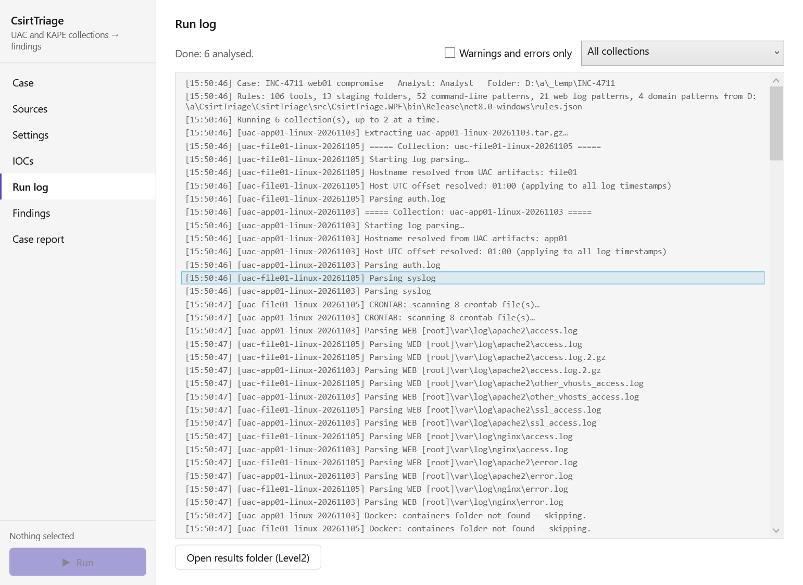
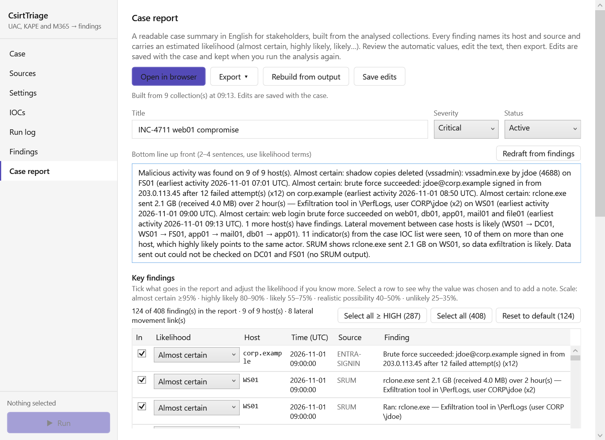
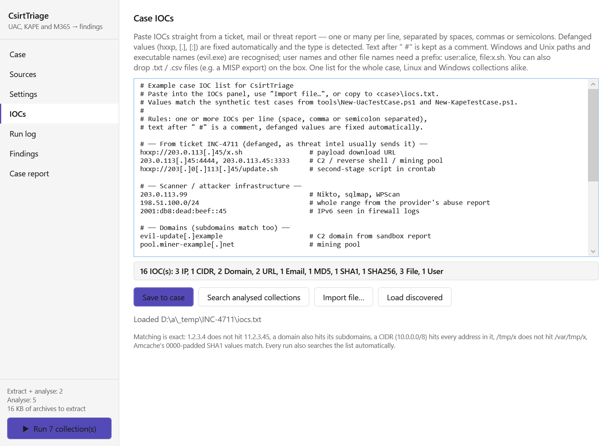
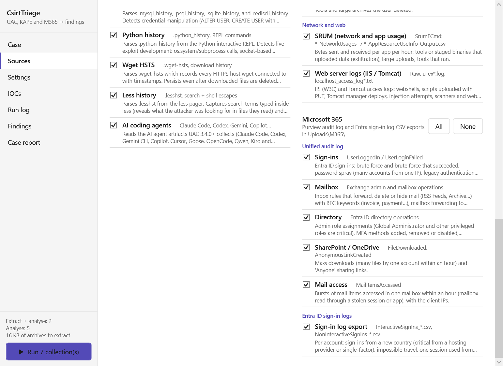

# CsirtTriage

DFIR triage for Windows analysts, in one desktop app for **Linux/Unix collections ([UAC](https://github.com/tclahr/uac))**, **Windows collections (DFIR ORC → KAPE)** and **Microsoft 365 unified audit log exports (Purview)**. It finds every collection in a case folder, lets you choose which to extract and analyse, runs several at the same time, and writes per-collection findings, a case summary and a case report across all hosts, Linux and Windows alike.

It replaces [CsirtParser.WPF](https://github.com/JuggeM/CsirtParser.WPF) (UAC) and [KapeAnalyser.WPF](https://github.com/JuggeM/KapeAnalyser.WPF) (KAPE). The detections are the same; what is new is the shared case layer: one IOC list, one case summary and one case report for the whole incident, so SSH from a Windows host to a Linux server (or the other way round) shows up as lateral movement.



## Screenshots

| Sources | Findings |
|---|---|
|  |  |
| **Run log** | **Case report** |
|  |  |
| **Case IOCs** | **Microsoft 365 sources** |
|  |  |

Screenshots use the synthetic test cases from `tools\` (all IPs from documentation ranges) and are taken by the Screenshots workflow whenever the app's UI changes; the newest are on the [`screenshots`](https://github.com/JuggeM/CsirtTriage/tree/screenshots/docs) branch.

## Download

Get `CsirtTriage.exe` and `rules.json` from the [latest release](https://github.com/JuggeM/CsirtTriage/releases) and keep them in the same folder (the zip holds both). The exe is a single self-contained file for 64-bit Windows: no install and no .NET runtime needed. SHA256 checksums are in the release notes.

**Test case:** every release also has `CsirtTriage-TestCase.zip`, a synthetic incident (all IPs from documentation ranges) across Linux, Windows and Microsoft 365 with collections in every state the app can show, a checklist for every panel and the expected results (`TESTING.md`). Unpack it to a short path such as `C:\Cases\` and open `INC-4711` as the case folder. Build it yourself with `tools\New-FullTestCase.ps1`.

To release a new version, push a tag (`git tag v0.2.0 && git push origin v0.2.0`) or start **Actions → Release → Run workflow** with the version: the release workflow builds, runs the regression tests and publishes the release.

## Case folder

```
CaseFolder\
├── Uploads\               UAC archives (uac-*.tar.gz) and DFIR ORC archives as received
│   └── M365\               Purview audit log and Entra sign-in log CSV exports (see docs/M365.md)
├── Decompressed\          extracted collections (UAC: by CsirtTriage; ORC: by your processing script)
├── Processed\             parsed data, level 1
│   ├── ORC_Server_FS01_…\  KAPE module output, written by the ORC processing script (read only)
│   ├── uac-web01-linux-…\  Normalized_<SOURCE>.csv per log source, ProcessedBodyFile.csv (scored file timeline) (UAC)
│   └── M365\                Normalized_UAL.csv (audit records with AuditData), Normalized_ENTRA.csv (sign-ins)
├── iocs.txt               case IOC list (IOCs panel)
└── Level2\                analysis results
    ├── CaseSummary.txt         hosts ranked, lateral movement, sources logging on to several hosts, IOCs across hosts, case timeline
    ├── CaseFindings.csv        every collection's findings in one file (Timeline Explorer)
    ├── CaseReport.html/.json   case report and your edits to it
    ├── CaseTracker.xlsx        critical and high findings as case tracker rows: sheet Hosts (UAC and KAPE), sheet M365
    ├── iocs_discovered.txt     indicators found in findings that are not in iocs.txt yet
    ├── _previous\              earlier results of re-analysed collections
    └── <collection>\
        ├── QuickWins.rtf           analyst report: case IOC hits, key findings, IOCs, coverage, one section per source
        ├── Findings.csv            one row per finding (time, severity, source, count, text, detail, artifact)
        ├── IocHits.csv             case IOC hits in this collection
        ├── Logons.csv              inbound logons by source (SSH, RDP, network, admin shares)
        ├── Sessions.csv            logon sessions with start, end and duration
        ├── host.txt                host name, IPs, collection type and source folder
        └── UAC only: Sessions_Full.csv (every session type), Sha1Candidates.csv (executables worth a hash lookup),
            DockerContainers.csv
```

Windows collections are processed by your ORC script (ORC → KAPE `!EZParser` → `Processed\<collection>`); CsirtTriage only reads that output. An ORC collection without KAPE output yet is listed as *waiting for KAPE*.

## Using it

1. **Case**: case name, analyst and case folder. The folder is scanned and every collection is listed with host, type, collection date, size and status:

   | Status | Run will |
   |---|---|
   | Not extracted (UAC archive) | extract, parse and analyse |
   | Extracted (UAC) | parse and analyse |
   | KAPE output ready | analyse |
   | Waiting for KAPE | nothing yet: run the ORC processing script first |
   | Audit log ready (M365) | analyse |
   | Analysed | re-analyse when ticked (earlier results move to `Level2\_previous`) |

   Everything not analysed yet is ticked. Tick or untick rows, then **Run**.
2. **Sources** (optional): switch UAC parsers or KAPE modules off. All are on by default.
3. **Settings** (optional): how many collections run at the same time (default: half the cores, at most 4), how many archives are extracted at once (default 1), a date range, detection thresholds, keywords, whitelists and the KAPE rules file.
4. **IOCs** (optional): paste indicators from the ticket or threat intel. One list for the whole case.
5. **Run**: each collection is its own job with its own status and progress in the table, and its own cancel button; one failing does not stop the others. The **Run log** can be filtered per collection. When the jobs are done, the case-wide steps run once: IOC search, case summary, case tracker, discovered IOCs.
6. **Findings**: every collection's findings in one grid, filtered by severity, host, source and text. **Case report**: likelihood per finding, bottom line, export to HTML, Word or RTF.

### Headless

The same scan and runner without a window, for scripts and CI:

```
CsirtTriage.exe --case X:\INC-4711 [--name <case>] [--analyst <name>] [--parallel 4]
                [--only <collection,collection>] [--reanalyse] [--uac-only | --kape-only | --m365-only]
                [--no-ioc-search] [--list]
```

`--list` prints the collections table and exits. Exit codes: 0 ok, 1 error, 2 usage, 3 some collections failed (see the log), 130 cancelled. The cross-platform `csirttriage` CLI (`src/CsirtTriage.Cli`) takes the same options and runs on Linux and macOS too.

## What it detects

### Linux / Unix (UAC)

| Parser | Source | What it detects |
|---|---|---|
| Auth / Secure | `auth.log`, `secure` | SSH brute force (and *succeeded* after failures), root logins, PAM failures, sudo abuse, account creation, privileged group changes |
| Syslog | `syslog`, `kern.log` | Kernel panics, OOM kills, segfaults, cron executions, pipe-to-shell |
| Messages | `/var/log/messages` | System daemon and kernel events |
| Audit | `audit.log` | execve, file access, privilege changes (auditd) |
| Web logs | Apache / Nginx access (combined, vhost_combined, common) and `error.log` | SQLi, LFI, command injection, XSS, webshells, scanners, login brute force, ModSecurity blocks (details below) |
| systemd Journal | `*.journal` (binary) | sudo, SSH, shell execution, cron, reverse shells |
| Crontab scanner | `/etc/cron*`, `/var/spool/cron` | Persistence, reverse shells, downloads, base64 payloads (decoded inline) |
| Bash / Zsh history | `.bash_history`, `.zsh_history` | Reverse shells, droppers, credential access, lateral movement (ssh/scp), writes to sudoers/authorized_keys, history clearing |
| AI coding agents | UAC 3.4.0+ `ai_tools` | Commands, file writes and prompts of Claude Code, Codex, Gemini CLI, Copilot, Cursor and more: secrets hunting, reverse shells, approval bypass, prompt injection (details below) |
| Python history | `.python_history` | REPL commands: sockets, subprocess, file access |
| Database history | MySQL, PostgreSQL, SQLite, Redis | Data access and dumps, user and privilege changes |
| Vim info / Less history | `.viminfo`, `.lesshst` | Files opened and edited, shell escapes |
| Wget HSTS | `.wget-hsts` | Hosts files were downloaded from |
| Docker | Container logs and events | Privileged containers, unusual image pulls |
| Live response | UAC `live_response`, `chkrootkit`, `system`, `[root]/etc` | Suspicious processes and connections, deleted binaries, logins from wtmp/btmp, `ld.so.preload` rootkits, UID 0 and sudo backdoors (details below) |
| Body file | `bodyfile.txt` | Scored file timeline: dropped tools, webshells, executable or hidden files in temp directories |
| SHA1 hashes | `hash_executables.sha1` | Executables outside system folders worth a hash lookup; all candidates in `Sha1Candidates.csv` (details below) |

<details><summary>Details</summary>

- **Web logs** (Apache / Nginx access (combined, vhost_combined, common) and `error.log`): URL-decoded SQLi, LFI/path traversal, command injection, XSS; webshells; scanners by user agent; login brute force; ModSecurity blocks; PHP exec warnings
- **AI coding agents** (UAC 3.4.0+ `ai_tools`: Claude Code, Codex, Gemini CLI, Copilot, Cursor, Goose, OpenCode, Qwen, Kiro and more): Every shell command, file write, fetch and prompt from agent transcripts (UTC); secrets hunting, reverse shells, uploads to raw IPs, writes to persistence files; hooks and MCP servers that run commands; approval bypass (`bypassPermissions`, yolo, `approval_policy = never`); prompt injection in `CLAUDE.md`/`AGENTS.md`; credential files present (never read)
- **Live response** (UAC `live_response`, `chkrootkit`, `system`, `[root]/etc`): Processes from temp paths, suspicious command lines, connections to C2/mining ports, processes running from deleted binaries (UAC-recovered), wtmp/btmp logins (external IPs, success after failed attempts), `/etc/ld.so.preload` rootkits (including entries only the raw disk read shows), UID 0 and passwordless accounts, `NOPASSWD:ALL` sudo, hidden files in temp folders, host IP addresses
- **SHA1 hashes** (`hash_executables.sha1`): Executables outside system folders scored by path (temp, home, `/dev/shm`), hidden names, suspicious names and extensions; every candidate in `Sha1Candidates.csv` for a threat-intel lookup, the top 100 as findings; case SHA1 IOCs are matched against it

</details>

### Windows (KAPE)

| Source | KAPE module output | What it detects |
|---|---|---|
| EVTX | `*_EvtxECmd_Output.csv` | Logons, brute force and spray, RDP, sessions, USB, WMI, accounts, services and tasks, PowerShell, Defender tampering, log clearing, Kerberoasting, DCSync (details below) |
| PREFETCH | `*_PECmd_Output.csv` | Known attacker and dual-use tools, executables run from staging folders |
| AMCACHE | `*_Amcache_*FileEntries.csv` | Same, with SHA1 |
| SHIMCACHE | `*AppCompatCache*.csv` | Same (times are file modification times) |
| REGISTRY | `*_RECmd_Batch_*_Output.csv` | Tools, staging paths and attack command lines in every value; autoruns; Defender exclusions; outbound RDP, shares and USB (details below) |
| LNK / JUMPLIST | `*_LECmd_Output.csv`, `*_AutomaticDestinations.csv` | Opened tools, malicious shortcut arguments, admin shares, removable media |
| MFT | `*_MFTECmd_$MFT_Output.csv` | Tools on disk, executables in staging folders, internet downloads (Zone.Identifier), timestomping (SI < FN), large archives, mass ransom notes |
| USNJRNL | `*_MFTECmd_$J_Output.csv` | Tools created, renamed or deleted; ransom notes; ransomware-style mass renames (details below) |
| RECYCLEBIN | `*_RBCmd_Output.csv` | Deleted tools and large archives |
| SHELLBAGS | SBECmd output | Tool and loot folder names, admin shares |
| SRUM | SrumECmd `NetworkUsages`, `AppResourceUseInfo` | Data sent out per app and user (exfiltration), tools that ran (details below) |
| BROWSER | SQLECmd Chromium / Firefox history and downloads | Visits to file sharing, paste, tunnel and remote-access sites and raw IPs; risky downloads (details below) |
| PSHISTORY | raw `ConsoleHost_history.txt` | Every PowerShell command typed, checked against the command-line rules (details below) |
| WEBLOG | raw IIS and Tomcat access logs | Webshells, uploads, Tomcat deploys, SQLi, traversal, ProxyShell, scanners, login brute force (details below) |
| SIGMA | Hayabusa or Chainsaw CSV | One finding per Sigma rule hit, severity from the rule level (details below) |

<details><summary>Details</summary>

- **EVTX** (`*_EvtxECmd_Output.csv`): **Logons:** brute force (4625/4771/4776) and *succeeded* after failures, RDP logons (4624 type 10, 1149, 21/25), network logons from external IPs, type 9 logons, admin shares (5140/5145), password spray (many accounts, few tries each), account lockouts (4740; five or more accounts is high), possible pass-the-hash (NTLM network logon with key length 0) and NTLMv1 logons, desktop logons at an hour the host almost never sees (needs 20+ sessions as a baseline). **USB:** removable disks connected (Partition/Diagnostic 1006: model, serial, size, time). **Sessions:** logon to logoff (4624 → 4634/4647 by logon ID) and RDP sessions (LocalSessionManager 21 → 24/25 → 23), with duration; RDP sessions from external IPs are reported with how long they lasted. **WMI:** event filters, consumers and bindings (Sysmon 19/20/21), permanent and temporary subscriptions (WMI-Activity 5861/5860), providers loaded from unusual paths (5857). **Accounts:** created and added to privileged groups. **Execution and persistence:** services (7045/4697), scheduled tasks (4698), process command lines (4688, Sysmon 1), shells started by a web server, Office, WMI or the print spooler (parent process), PowerShell (4104, 400/600/800), autorun registry writes (Sysmon 13), WMI subscriptions, BITS jobs. **Defence evasion:** Defender detections, exclusions and tampering, log clearing (1102/104), LSASS access (Sysmon 10). **Domain controller:** Kerberoasting (RC4) and DES tickets (4769), DCSync (4662), AdminSDHolder / delegation / shadow credential / GPO changes (5136), computer accounts created or given delegation by a user (4741/4742)
- **REGISTRY** (`*_RECmd_Batch_*_Output.csv`): Every value checked for tools, staging paths and attack command lines (UserAssist, BAM, RunMRU, services, …); autoruns; Defender exclusions; host name and IPs. **Where this host connected out to:** RDP targets (Terminal Server Client, with the saved user name), mapped drives and network shares (Map Network Drive MRU, `Network\<letter>`, MountPoints2, typed UNC paths; admin shares such as `C$` are high). **USB:** storage devices (USBSTOR, with serial) and portable devices. A share or RDP target that is another case host counts as lateral movement, by IP or by name
- **USNJRNL** (`*_MFTECmd_$J_Output.csv`): Tools created, renamed or deleted; prefetch files created for tools; mass ransom notes. **Ransomware encryption:** many files renamed to the same new extension (100+ in 3+ folders, or 50+ that keep their old extension, e.g. `Q3.xlsx.lockfs`) is critical; a minute with 1000+ files overwritten or renamed is high. Common extensions (`.tmp`, `.bak`, `.crdownload`, …) are ignored
- **SRUM** (`*_SrumECmd_NetworkUsages_Output.csv`, `*_AppResourceUseInfo_Output.csv`): Data sent out per app and user: known tools or staged binaries that uploaded data (exfiltration, e.g. "rclone.exe sent 2.1 GB"), other large uploads (normal uploaders such as OneDrive are ignored); tools that ran
- **BROWSER** (SQLECmd: `*_ChromiumBrowser_HistoryVisits_*`, `*_ChromiumBrowser_Downloads_*`, `*_Firefox_History_*`, `*_Firefox_Downloads*`): Chrome, Edge and Firefox, per user (from the profile path). Visits to file sharing, paste, tunnel and remote-access sites (`suspiciousDomains` in rules.json) and to raw external IP addresses; downloads of known tools, into staging folders, and of executables or archives from a raw IP or a listed site
- **PSHISTORY** (raw file: `Users\<user>\AppData\Roaming\Microsoft\Windows\PowerShell\PSReadLine\ConsoleHost_history.txt`): Every command typed in PowerShell, checked against the command-line rules (download cradles, encoded commands, Defender changes, history cleared, …), known tools and staging folders. The file has no timestamps, so these findings have none; the artifact column shows when the file was last written
- **WEBLOG** (raw files: IIS `u_ex*.log` (W3C) and `u_nc*.log`, Tomcat `localhost_access_log*.txt`): Webshells (known shell names, scripts in upload folders, with the commands passed to them), scripts uploaded with PUT, Tomcat manager deploys, SQL injection, path traversal, command injection, XSS, Exchange ProxyShell probes, sensitive file probes, scanners by user agent, and web login brute force with success (as in the CSIRT UAC Parser). Grouped per client IP and type; an attack the server answered with 2xx/3xx is high (webshell: critical), otherwise medium. The patterns are the `web*` entries in rules.json
- **SIGMA** (Hayabusa `dfir-timeline` CSV or Chainsaw `hunt --csv`, with `hayabusa` or `chainsaw` in the file name (or `sigma.csv`)): One finding per Sigma rule (and computer) with count and first/last time. Severity from the rule level (critical, high, medium; low = suspicious); informational hits are skipped. Columns are found by name, so any Hayabusa output profile works; timestamps with a UTC offset are converted to UTC. Chainsaw output has no level, so its hits are medium

</details>

### Microsoft 365 (unified audit log)

Purview **Audit** search exported as CSV (current layout with `RecordId, CreationDate, RecordType, Operation, UserId, AuditData`, or the classic `CreationDate, UserIds, Operations, AuditData`), put in `Uploads\M365\`. The tenant is shown as a host named after its mail domain; successful sign-ins go to `Logons.csv`, so an attacker IP that also logged on to case machines is linked in the case summary.

| Source | Operations | What it detects |
|---|---|---|
| M365-SIGNIN | `UserLoggedIn`, `UserLoginFailed` | Brute force (and *succeeded*), password spray (many accounts from one IP), legacy authentication (BAV2ROPC) and scripted clients (python, Go, curl, AADInternals…), one account from many IPs in a day |
| M365-MAILBOX | Exchange cmdlets, OWA `UpdateInboxRules` | Inbox rules that forward, delete or hide mail (RSS Feeds, Archive…), critical with BEC keywords (invoice, payment…); mailbox forwarding (critical to external domains); FullAccess/SendAs; transport rules; audit logging switched off; IMAP/POP enabled; eDiscovery searches and exports |
| M365-DIRECTORY | Entra ID audit | Admin roles (Global Administrator and other privileged roles critical), MFA added/removed/disabled, password resets, accounts created/deleted, app consent (admin consent critical), app credentials, domain federation changes, conditional access |
| M365-FILES | `FileDownloaded`, `AnonymousLinkCreated` | Mass downloads (files per account per hour), 'Anyone' links |
| M365-MAILACCESS | `MailItemsAccessed` | Mail items accessed per mailbox per hour |

Entra ID **sign-in log** exports (CSV, interactive and non-interactive, usually for the few accounts under investigation) go in the same folder and are told apart by their columns:

| Source | Export | What it detects |
|---|---|---|
| ENTRA-SIGNIN | `InteractiveSignIns_*.csv`, `NonInteractiveSignIns_*.csv` | Per account: new country (critical from a hosting provider or single-factor), impossible travel, one session used from two countries (stolen session token, AiTM), correct password stopped by MFA, MFA fatigue, brute force, legacy protocols, scripted clients, Conditional Access blocks, risky sign-ins |

Thresholds are in **Settings → Microsoft 365 detection**; user agents, hidden folders, BEC keywords, privileged roles, hosting providers' AS numbers and legacy client apps in the `m365` section of `rules.json`.

**[What to collect from Microsoft 365, how, and what each finding means → docs/M365.md](docs/M365.md)**

KAPE detection patterns (tools, staging folders, command lines, web attacks, suspicious domains) are in `rules.json` next to the exe, so analysts can edit them; **Settings → Windows detection** reloads it.

## Case IOC list

Paste indicators in the **IOCs** panel, several per line if you like. Defanged values (`203.0.113[.]45`, `hxxp://`) are fixed and the type is detected: IP, CIDR, domain, URL, e-mail, MD5/SHA1/SHA256, Unix and Windows paths and executable names. User names and other file names need a prefix: `user:alice`, `file:x.sh`. Text after ` #` is a comment. The list is saved as `iocs.txt` in the case folder.

Matching is exact: `1.2.3.4` does not hit `11.2.3.45`, a domain also matches its subdomains, a CIDR matches every address in it, `/tmp/x` does not hit `/var/tmp/x`, and Amcache's `0000`-padded SHA1 values match. UAC collections are searched in their normalised logs, body file and raw live response output; KAPE collections in every EZ Tools CSV, including columns no analyser reads. Hits go to the top of the collection's QuickWins, to `IocHits.csv` and to the case summary, and raise the likelihood of matching findings in the case report. **Search analysed collections** runs the search again without re-analysing.

## Build and test

Requires the [.NET 8 SDK](https://dotnet.microsoft.com/download/dotnet/8.0).

```
dotnet build CsirtTriage.sln -c Release
dotnet publish src/CsirtTriage.WPF -c Release -r win-x64 --self-contained -p:PublishSingleFile=true
```

| Project | |
|---|---|
| `src/CsirtTriage.Core` | everything except the UI: UAC parsers, KAPE analysers, M365 audit log analysis, the shared case layer (scan, runner, IOCs, reports). Plain `net8.0`, builds and runs on any OS |
| `src/CsirtTriage.WPF` | the Windows app (`CsirtTriage.exe`) |
| `src/CsirtTriage.Cli` | headless runner, any OS |

Regression tests build synthetic cases (all IPs from documentation ranges) and run the headless runner against them; they run in CI on every push and work on Linux with PowerShell 7:

```
.\tools\Test-UacDetections.ps1  -Exe src\CsirtTriage.Cli\bin\Release\net8.0\csirttriage.dll
.\tools\Test-KapeDetections.ps1 -Exe src\CsirtTriage.Cli\bin\Release\net8.0\csirttriage.dll
.\tools\Test-M365Detections.ps1 -Exe src\CsirtTriage.Cli\bin\Release\net8.0\csirttriage.dll
.\tools\Test-MixedCase.ps1      -Exe src\CsirtTriage.Cli\bin\Release\net8.0\csirttriage.dll
```

## Antivirus

`rules.json` and the test case scripts contain attacker strings (tool names, command lines) as text. The executable does not. If your antivirus quarantines a file anyway, add an exclusion for that folder, following your organisation's policy.

## Changes from CsirtParser and KapeAnalyser

- One case folder layout and one results folder (`Level2\`, was `Processed\` for UAC and `Processed\Level2\` for KAPE). UAC normalised CSVs stay in `Processed\`.
- Collections are chosen in a table and run in parallel; re-analysing no longer needs folders deleted by hand.
- Dropped: `QuickWins.txt` (the RTF is built from a hidden `.quickwins.txt`), `Findings.tsv`/`IocHits.tsv` (now `.csv`), `Sessions_AUTH.csv` (now `Sessions.csv` and `Logons.csv` in the shared layout), `Audit_Parsed.csv` (merged into `Normalized_AUDIT.csv`, every line), `LiveResponseFindings.txt` (a raw copy of the live response files; the findings are in QuickWins and the files in `Decompressed\`), and the UAC options that only controlled that copy or nothing (Processes, Network, Persistence, File system; four Output toggles).
- UAC findings now also feed lateral movement by logon (accepted SSH logons in `Logons.csv`), not only by host IPs seen in other hosts' findings.

## License

MIT, see [LICENSE.txt](LICENSE.txt).
