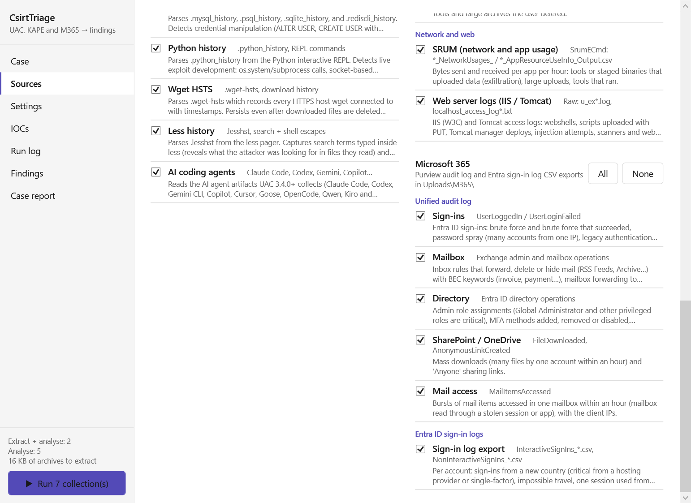

# Microsoft 365: what to collect and what CsirtTriage looks for

CsirtTriage reads two Microsoft 365 exports, both as CSV:

| Export | From | Scope |
|---|---|---|
| **Unified audit log** | Microsoft Purview → Audit | The whole tenant if you can, otherwise the accounts under investigation plus the admins |
| **Entra ID sign-in logs** | Microsoft Entra admin center → Sign-in logs | The accounts under investigation (usually 1–5) |

Put every file in the case folder under **`Uploads\M365\`**, in the same folder. CsirtTriage tells the files apart by their columns, so the file names don't matter, with one exception: non-interactive sign-in files must keep **`NonInteractive`** in their name (see below). One folder is one collection. The tenant shows up as a host named after its mail domain (e.g. `corp.example`), next to the case's Linux and Windows hosts.

## Before you export

- **Permissions:** the *Audit Logs* or *View-Only Audit Logs* role for Purview, and *Reports Reader*, *Security Reader* or *Global Reader* for the Entra sign-in logs.
- **Retention:** both logs are only kept for a limited time, depending on the tenant's licenses. Entra sign-in logs are the shortest (days to a month), so **export them first**, before anything else in the incident.
- **Time range:** from at least **2–4 weeks before** the first known suspicious activity until today. A BEC account is often taken over long before anyone notices, and the analysis needs normal activity to compare against (for example the account's usual country).
- **MailItemsAccessed** (which mail was read) is only in the audit log if the tenant's license includes it. If it's missing, the "mail access burst" check finds nothing. That doesn't mean nothing was read.

## 1. Unified audit log (Purview)

1. Open **purview.microsoft.com** → **Audit** (*Solutions → Audit*) → **New search**.
2. **Date and time range (UTC):** as above.
3. **Activities:** leave empty (all activities).
4. **Users:** leave empty if the tenant isn't too big. If you have to narrow it down, enter the accounts under investigation **and the tenant's admin accounts**. With a narrowed search you lose password spray against other accounts, and changes an attacker makes through another account (for example a role assignment or mailbox forwarding set by an admin account).
5. **Workloads / record types:** leave empty.
6. Name the search after the case, start it and wait until it shows *Completed*.
7. Open the search → **Export** → download the CSV.
8. Put the file in `Uploads\M365\`.

If the search is too large for one export, split it by date into several searches and put all the files in the same folder. Both Purview's current CSV layout and the older one (`CreationDate, UserIds, Operations, AuditData`) are read.

## 2. Entra ID sign-in logs (per account)

1. Open **entra.microsoft.com** → **Identity → Monitoring & health → Sign-in logs**.
2. **Date:** *Custom time interval*, the same range as the audit log, as far back as the portal allows.
3. **Add filter → User:** enter the account (UPN). One account at a time.
4. The **User sign-ins (interactive)** tab: **Download → Download CSV**.
5. The **User sign-ins (non-interactive)** tab: **Download → Download CSV**. Don't skip this one. Stolen session tokens show up here, not among the interactive sign-ins.
6. Repeat for each account.
7. Put the files in `Uploads\M365\`, unzipped if they came as a zip.

**File names:** the files are called `InteractiveSignIns_<dates>.csv`, `NonInteractiveSignIns_<dates>.csv` and `…_AuthDetails_….csv`. If you download several accounts, the names will clash. Add the account to the name, but **keep `NonInteractive` in the name** of the non-interactive files, because that's how CsirtTriage tells them apart. Example: `NonInteractiveSignIns_jdoe_2026-11.csv`. The `AuthDetails` files can go in the folder too; they're skipped.

The portal limits how many rows one download can have. If an account has more sign-ins than that in the period (non-interactive sign-ins can be many), split the period into shorter ranges.

## 3. Run

Open the case folder in CsirtTriage. The collection shows up in the table as **M365 – Audit log ready**. Run it, alone or together with the rest of the case. The run log says how many rows were read from each file:

```
[M365] Audit_Search_INC-4711.csv: 243 record(s)
[M365] InteractiveSignIns_jdoe_2026-11.csv: 30 Entra sign-in(s)
[M365] NonInteractiveSignIns_jdoe_2026-11.csv: 10 Entra sign-in(s)
[M365] InteractiveSignIns_AuthDetails_….csv: Entra authentication details — not used
```

**Check these numbers against the exports.** If a file reads 0 rows, the export format has changed: report it, and attach the file's header row.

**Output:**
- **`Processed\M365\`:** `Normalized_UAL.csv` (every audit record with its full AuditData) and `Normalized_ENTRA.csv` (every sign-in).
- **`Level2\M365\`:** `QuickWins.rtf`, `Findings.csv`, `Logons.csv` (successful sign-ins per account and IP) and `IocHits.csv`.

The case IOC list is searched in both normalised files.

## What the parser looks for



Severities follow the rest of CsirtTriage: **CRITICAL** (act now), **HIGH** (very likely malicious), **MEDIUM** (check it), **SUSPICIOUS** (worth knowing about). Thresholds are set in **Settings → Microsoft 365 detection**, and patterns in the `m365` section of `rules.json`.

### Sign-ins in the audit log (`M365-SIGNIN`)

| Finding | Severity | What it means |
|---|---|---|
| Brute force succeeded | CRITICAL | 10+ failed sign-ins for an account from one IP, then a successful one from the same IP |
| Password spray | HIGH | One IP with failed sign-ins against 5+ accounts |
| Legacy authentication (ROPC) | HIGH | A sign-in with BAV2ROPC: a password-only protocol that bypasses MFA, common in attack tools |
| Scripted client | HIGH | User agent of a script or attack tool (python-requests, Go, curl, AADInternals, …) |
| Many sign-in IPs | MEDIUM | An account signs in from 5+ IPs in a day |
| Brute force | MEDIUM | 10+ failures from one IP without a success |

### Sign-ins in the Entra export (`ENTRA-SIGNIN`), per account

Each account's **usual country** is the one most of its successful sign-ins come from.

| Finding | Severity | What it means |
|---|---|---|
| New country | HIGH; CRITICAL from a hosting provider or single-factor | First successful sign-in from a country the account doesn't usually use. Hosting/VPS providers (DigitalOcean, AWS, Hetzner, …, by AS number) are rarely real users |
| Impossible travel | HIGH | Successful sign-ins in two countries less than 2 hours apart |
| Session in two countries | HIGH | The same session ID used from two countries: a session token stolen and replayed elsewhere, typical of adversary-in-the-middle phishing (Evilginx and similar). Often only visible in the non-interactive sign-ins |
| Password known | HIGH | Correct password from an IP the account never signed in from successfully, stopped only by the MFA requirement (errors 50074/50076/50079). The password should be reset |
| MFA fatigue | HIGH; CRITICAL if a success follows | 3+ MFA prompts denied or failed from one IP (error 500121); critical if the account signs in from that IP within an hour |
| Brute force | MEDIUM; CRITICAL if a success follows | 10+ wrong passwords from one IP |
| Legacy authentication | HIGH on success, MEDIUM on failure | IMAP, POP, SMTP, ActiveSync and other protocols that can't do MFA |
| Scripted client | HIGH on success | User agent of a script or attack tool |
| Conditional Access | MEDIUM | Blocked by a Conditional Access policy; the password was accepted |
| Risky sign-in | HIGH (high risk), MEDIUM (medium risk) | Entra ID Protection's own risk level, when the export has it (requires Entra ID P2) |

### Mailbox (`M365-MAILBOX`)

| Finding | Severity | What it means |
|---|---|---|
| Inbox rule that forwards, deletes or hides mail | HIGH; CRITICAL with BEC keywords | Rules that move mail to RSS Feeds, Archive, Conversation History and similar, delete it or forward it. Critical when the conditions contain words like invoice, payment, bank or password: the attacker hides replies about the fraud |
| Mailbox forwarding | HIGH; CRITICAL to an external domain | `ForwardingSmtpAddress` set on a mailbox. "No copy kept" means the user doesn't see the mail either |
| Mailbox permission | MEDIUM | FullAccess / SendAs granted to another account |
| Transport rule | MEDIUM; HIGH if it redirects or copies mail | Organisation-wide mail flow rules |
| Audit logging switched off | CRITICAL / HIGH | The unified audit log switched off (critical), or mailbox auditing or audit bypass for a mailbox. Expect a gap in the log after this |
| Mail protocol enabled | MEDIUM | IMAP/POP/EWS/ActiveSync switched on for a mailbox |
| eDiscovery | MEDIUM; HIGH for export/purge | Content searches across mailboxes, and their export or download: a way to steal mail at scale |
| Other inbox rules | SUSPICIOUS | Listed so you can see every rule that was created |

### Directory (`M365-DIRECTORY`)

| Finding | Severity | What it means |
|---|---|---|
| Admin role | HIGH; CRITICAL for privileged roles | Global Administrator, Exchange/Security/Privileged Role Administrator and other privileged roles are critical |
| App consent | HIGH; CRITICAL for admin consent | Consent to an application. Illicit consent gives an attacker access that survives a password reset |
| App credentials | HIGH | Secrets or certificates added to an application: persistence |
| Domain federation | CRITICAL | Federation settings changed: can let an attacker sign in as any user |
| MFA | MEDIUM; HIGH if MFA is disabled | MFA methods added or removed. An attacker registering their own authenticator is common right after a takeover |
| Password reset, account created or deleted | MEDIUM | |
| Conditional access policy changed | MEDIUM; HIGH if deleted | |

### Files and mail access

| Finding | Source | Severity | What it means |
|---|---|---|---|
| Mass download | `M365-FILES` | HIGH | 100+ files downloaded by one account within an hour |
| 'Anyone' links | `M365-FILES` | MEDIUM | Sharing links that work without signing in |
| Mail access burst | `M365-MAILACCESS` | HIGH | 500+ mail items in one mailbox read within an hour (MailItemsAccessed) |

### Connections to the rest of the case

- **Successful sign-ins go to `Logons.csv`.** In the case summary, an IP that signed in to M365 and also logged on to a case machine (RDP, SSH) shows up under *Sources logging on to several hosts*, together with the accounts used.
- **The case IOC list is searched in every record.** IPs, domains (also in forwarding addresses and rule actions), URLs and accounts all count.
- **M365 findings sit in the same Findings view and case report** as the Linux and Windows findings, in one timeline.
- **In `CaseTracker.xlsx`, M365 findings have their own sheet** with columns that fit a tenant: Tenant, Account, Source IP, Location, Eventdescription and Target (mailbox, application, role, file), next to the Hosts sheet for Linux and Windows.

## Not covered (yet)

- Gaps in the log, for example after audit logging was switched off, aren't flagged. Check the timeline yourself.
- Current mailbox state (`Get-InboxRule -IncludeHidden`, forwarding as it is now), message trace and OAuth grants aren't read. Secure them separately.
- Countries come from Microsoft's own geolocation in the sign-in export. The audit log has no country, so "new country" and "impossible travel" need the sign-in export.
- Built and tested against Microsoft's documented export formats and synthetic data. Check the record counts in the run log the first time you use a new export.
